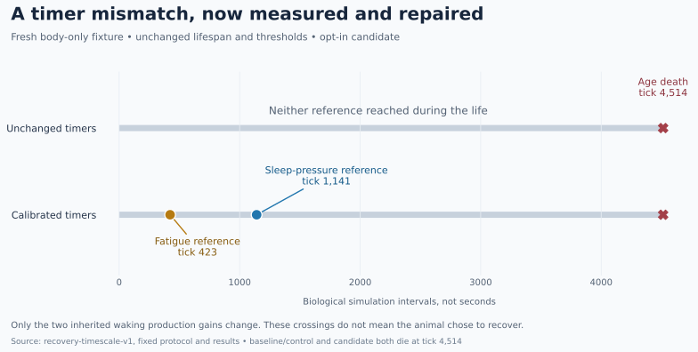

# Brain surgery handoff, 8 November 2026, 20:58 UTC

## Reference and standard of evidence

Keep [Sparks of Weight-Space Programming](https://rikiyat.github.io/blog/weight-space-programming/) in the next handoff. Experiment 4 motivates targeted repair; Experiment 5 builds entire 20,486-weight game networks; Experiment 6 iterates from feedback. Our animal is recurrent, embodied and plastic. A circuit, a changed logit, a changed sampled action, a useful outcome and learned competence are different results.

Creatures 3 / Docking Station is a near-ideal functional reference, not a mandatory clone. The [official Genetics Kit manual](https://cdn.cloudflare.steamstatic.com/steam/apps/1838430/manuals/Genetics_Kit_Manual.pdf?t=1640163808), pages 46–48, supports distinct tiredness/sleepiness and crisis-related chemistry. Navigation chemicals are 199–203 in the original catalogue, rather than 163–167. Backup reactions vary by genome. Suppressing attention to a need must not erase its biological deficit.

## Accepted body mechanism

[PR 318](https://github.com/BobertNeek/A-Life/pull/318) merged at `68beb760f61fddd9f838221f75b006748845d821`, tree `e8b75aebef97d6f85b2cafb0ca72f170e4ea3008`. All 21 reported PR-head checks and all 19 post-merge main checks passed. External review wrappers are not approvals: Codex was quota-blocked and Jules incomplete. Local preservation review and tests remain the source evidence.

This is an opt-in inherited awake-rest mechanism. It gives real fatigue relief without bodily sleep, memory sleep, SleepPressure relief, nutrition or an ATP gift. Ordinary Rest still produces body sleep. Old genomes, default births and old save bytes remain unchanged. It does not yet add a new ordinary neural action.

## Recovery timing: a biological mismatch and fresh-only repair

The unchanged fresh founder dies normally at age 4,514 with fatigue and pressure both 0.31487438. Neither reaches the controller references, fatigue 0.35 and pressure 0.60. These were not merely missing neural wires: the biological timers were too slow for this founder's life.

A separate inherited calibration changes only the two Awake production gains, fatigue from 0.00007 to 0.0012 and pressure from 0.00007 to 0.0006. Baseline, retention, receptors, thresholds, value weights, development, energy costs and lifespan stay fixed. No concentrations are patched and age death remains enabled.

In the fresh body-only fixture, fatigue first crosses at 423 and pressure at 1,141; both arms still die at 4,514. At naturally accumulated age 1,200, real awake rest reduces fatigue from 1 to 0.300000012 while pressure rises from 0.634735227 to 0.635313511. Real body sleep clears pressure to zero. A separately declared script produces four actual pressure crossings at 1,141 / 2,210 / 3,310 / 4,410, but its recovery actions are scripted. This is repeatable physiology, not autonomous sleep preference.

Source: `64feab7d925bfbc27f3c812aa138b90c44128877`, tree `0b65ebdd4a176eba13886d76817610ae59d7ce59`. Validation: 483 passed, three existing timing ignores; strict all-target core/world Clippy, formatting and boundaries passed. Six fresh ordinary/awake-rest portable saves at ages 0/240/1,200 are byte-identical to accepted main. Valid inheritance/mutant round trips pass. The first audit-example private-API failure is retained and corrected; no parameter was fitted to it.

Published [draft PR 319](https://github.com/BobertNeek/A-Life/pull/319) is exact head `ff17c294de569be806996cae4e54858de4f1e91b`, tree `9140d525fe1af16fed6539c3178a1a45e1fb04d0`. All 22 published blobs match the cleaned source/evidence bundle; production/test bytes are unchanged. Nine focused fixtures pass again. Exact-head CI is pending. This remains opt-in and does not rewrite old creatures.

## M1: complete fixed CPU sleep-choice qualification

Source `de806fcfec1570bd82ad5e618efeb97d5915555e`, tree `254321e7e9db0637d9926d9d5d16706ecef5394f`, now has 508 passing tests and four existing intentional/manual ignores. Strict core/world/training Clippy and formatting pass. All 18 old saves and 18 old receipts are byte-identical. No default, GPU, live-game or old-life migration is admitted.

M1 adds a true pressure/reference pair, explicit BodySleep and AwakeRest operations, operation-scoped Rest memories and voluntary sleep admission, retaining emergency recovery. Distinct lineage and source seals reject incompatible research envelopes before ambiguous positional decoding. Existing source neural/innate/memory routes remain; this is additive coordination, not total motor centralization.

The low-pressure normal-life fixture naturally selects awake rest four times over 32 host intervals and no body sleep. At pressure 0.008661905 against reference 0.6, it is a useful execution/restore control, not proof of correct long-term policy.

A separate fixture explicitly disables age death at birth and prepares 10,000 body-only intervals, without concentration edits. It starts at real pressure 0.6231508. A native three-microstep frame samples BodySleep. Over the declared 32 host intervals there are 24 neural decisions: one BodySleep, three AwakeRest, 20 with neither recovery operation. The host enters sleep at 10,001, commits one consolidation at 10,005, enters Waking at 10,006, is Awake at 10,009 and resumes a native decision. Full uninterrupted/cold-restored checkpoint bytes match throughout, including nonzero somatic/memory state and explicit test-owned optimizer sentinels. Those sentinels are not trained-life input. The high-pressure result is a long-lived mechanism fixture, not ordinary-life sleep competence or isolated pressure causality.

The original ineligible founder had no Posture head despite Rest logits. That failure remains. The replacement has four inherited heads authored before expression. Its fixed bounded reader differs from the earlier B1 brain: 4,096 coordinates, 592 nonzero, maximum absolute weight 0.01375. Actual drive/hormone/energy coefficient mass is 1.5228573; direct pressure valuation stays zero. Adding the second Rest operation also changes family prior mass. Full/Sham comparisons keep the same repertoire; comparison with old M0 cannot isolate pressure wiring.

## Social reference: measured correction to the earlier hypothesis

Measured source `7cb06e4c9d3daf4ed6c55104e1cec508177f2a23`, final documentation `56c6164e63a875dba01fc8194a002a19b8ec472a`. Canonical loneliness rebounds toward its inherited regulatory baseline after real contact. At full expression this founder's baseline is about 0.15, below frozen M0 reference 0.35. Native dendritic rectification yields zero loneliness contribution, not a negative penalty. Earlier speculation about negative suppression is superseded by this native measurement.

A separately bound detached probe uses a prospectively declared reference of half the actual isolated baseline, about 0.075. Native component is zero on steps 1–2, +0.004497111 on 3, +0.011283852 on 4 and +0.036307976 on 32. Real contact relief takes the component to zero and isolation rebound restores it. The source prefix, unrelated logits and controller work remain exact against controls. All 32 explicit steps are asserted; only 1/2/3/4/8/16/32 summaries are retained. This changes an encoder reference in a separate probe, not the frozen compiler or an admitted host/checkpoint. No action was sampled and no social-behavior gain is claimed.

A narrow research-world correction validates class-5 peers and makes them passively non-breeding instead of throwing an unsupported-brain error during ordinary proximity processing. It does not grant reproduction. Ordinary-body twin and actual class-5 contact/rebound biology match. Independent source/evidence review found no blocker. This research-dependent correction is not silently on main.

Reproductive contribution is zero in the juvenile fixture; peer identity is not mate eligibility. Grounded lane 41 is an observed-peer cue; lane 42 is targetless vocal opportunity, not a mating cue. Incremental 96 appended-neuron updates are not total brain work.

## Active next comparison and remaining drives

The next composed founder is explicitly B1 plus the already qualified bounded M1 reader and four inherited heads. Original B1 has zero inherited memory-reader weights; this composition must not be called unchanged B1 or a learned reader. Timer Full/old versus calibrated and pressure Full/Sham use the same common founder, repertoire, reader, scene and sampler, with pressure valuation still zero.

Prospective pilot: seed `0x03534C5000000001`, intentionally shared across four matched arms; 240 biological development intervals then at most 1,200 ordinary host intervals per arm, normal age death and health/energy stops, no retries or horizon extensions. A bounded scan of 52,309 tracked source/public-text paths in 56 local checkouts found no conflict, and the project owner knows of none. This is not a global freshness proof. The seed is reserved; activation remains off until source, optimized executable and fixed replay/restore qualification are bound. No result is claimed.

A new source audit found boredom really accumulates awake and Play relieves it, but the appended lobe sends boredom only toward Inspect. Its Other-family output is gated to targetless vocalization, giving object-bound Play zero added motor signal. A separate opt-in repair is being designed with native sign/latency, toy/non-toy success/failure, operation-isolation and urgency controls. It must remain an activity prior, not hidden semantic knowledge of toys, and must not disturb the sleep pilot.

## What remains unproved

The closed four-life M0 food/toy comparison changed some food selections but did not improve meal or recovery timing; toy actions and biology matched. Nothing above establishes a generally learned self-care policy, broad behavioral benefit, reliable social/reproductive competence, complete drive centralization, GPU parity or safe migration of existing acquired skills. Current work addresses the discovered biological timescale and missing action pathways before claiming those outcomes.
