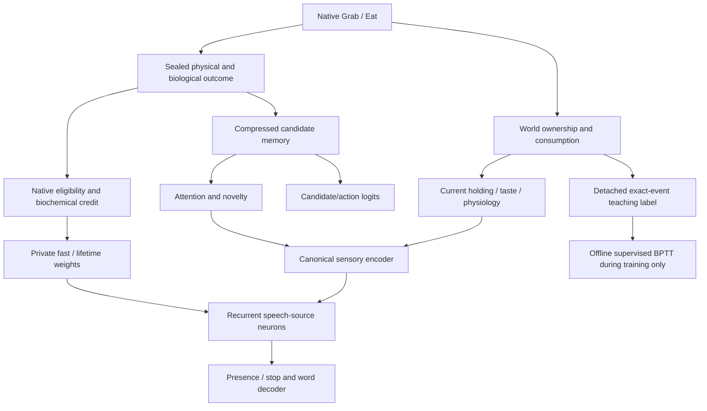

# Native physical evidence available to speech

The measured CPU V3 path carries immediate ownership and taste evidence into
speech. The audit found no accidental disconnection or small implementation fix
established by these sources and captures. It found an important representation
boundary: teaching labels know exact recent physical events, while the actor gets
current bodily senses, recurrent/private history and compressed candidate memory.
Speech has no direct object-specific episodic-recall feature.

This is a source/read-only audit at `b8bd8c4132af5c6c578a7d3299670802234940f5`.
[Numeric receipts and test design](retained-language-native-evidence-audit-results.json)
come from existing V26/V28 captures. There are **zero** new world decisions,
neural forwards, gradient probes, optimizer/shadow updates or model/Jules calls.
All **426** protected prior files remain byte-identical. No engine, admission,
checkpoint schema, trained state or default asset is changed. The failed offline
separator is not applied.

The memory-to-attention path is indirect. The candidate-memory values used by
an action readout are not direct inputs to the conditional speech decoder.

## Physical execution and earliest observation

[Grab](../../crates/alife_world/src/headless.rs#L5465) validates reach, ownership
and manipulation, changes `carried_by`, synchronizes the grip pose and returns
an Acquired/Released `GripTransfer`. [Eat's hands-on preparation](../../crates/alife_world/src/headless/hands.rs#L50)
may first acquire loose food while retaining selected action ID 210 (Eat).
A later [Eat](../../crates/alife_world/src/headless.rs#L5552) consumes self-held
food, clears ownership, records `PhysicalContactKind::Consumed`, nutrition and
an organism-specific taste sample. Pickup itself gives no nutrition.

The current decision's neural activity precedes that physical action. The first
following perception can observe its result. In the existing V28 matched pair:

| Seed 19508423 | Before pickup, both scenes | Next decision, near | Next decision, far |
|---|---:|---:|---:|
| Raw tactile holding | 0 | 1 | 0 |
| Encoded neuron 1858 | -0.655554 | -0.321407 | -0.732723 |
| Speech-source neuron 1858 | -0.092207 | +0.384499 | -0.026801 |

The near action genuinely acquires food; the far action inspects it. The initial
value of neuron 1858 at the next decision is identical in the two captures, as
are word lanes and current speech offsets. These are actual recorded values,
not a new sensory intervention or a claim that all other history is identical.

[Physical sensing](../../crates/alife_world/src/headless.rs#L3977) exposes holding
as tactile index 2 for any self-carried object, including indexed nonvisual
perception. It is not a food-specific or recent-acquisition label. Object identity
must come from ordinary object observations/attention and history. Taste is
sampled chemistry at tactile indices 5/6, independently of a removed food object.

## Actual encoder and gate path

The flat sensory ABI places tactile indices 0..7 at lanes 32..39. The explicit
[V3 embodied-speech assignments](../../crates/alife_core/src/phenotype/io_compile.rs#L71)
route those eight lanes to speech-source offsets 0..7, with gain 0.5. Therefore:

| Physical signal | Flat sensory lane | Speech-source neuron | Presence / stop synapses |
|---|---:|---:|---|
| Holding | 34 | 1858 | 27728 / 27729 |
| Positive taste | 37 | 1861 | 27824 / 27825 |
| Negative taste | 38 | 1862 | 27856 / 27857 |

The same bank also receives raw heard-word bits and homeostasis. The
[encoder](../../crates/alife_training/src/cpu/input.rs#L8) applies actual attention,
interoception and regional gains/clamps. The [native recurrent update](../../crates/alife_training/src/cpu/replay.rs#L111)
combines encoded input with the saved neural state, recurrent/dendritic input,
threshold and metabolic terms. V3's source neurons use the native identity/leak-1
equation; they are not an isolated text classifier.

[Speech decode](../../crates/alife_training/src/cpu/input.rs#L262) reads all 32
source activations with actual private effective-weight offsets. Presence and stop
use native threshold zero. Only decoder input lanes 18..31 are replaced by
recurrent control outputs after the first token; holding/taste lanes 2/5/6 remain
available across the phrase. They are mixed features, not clean Boolean facts.

On the matched pair, the original holding-receiving neuron's weights are
+0.166568 (presence) and -0.0688125 (stop), with zero private offset on these two
coordinates. Its observed term differences are **+0.068510 / -0.028303**,
within total gate differences **+0.120068 / -0.083196**. This establishes an
active nonzero source-to-gate term. It does not isolate holding causally: the
neuron also receives word/recurrent context, and physiology/history differ.
No cause is inferred from the failed offline fit.

## Stored outcomes, memory access and sleep

The [CPU host](../../crates/alife_training/src/cpu/host.rs#L1384) seals actual joint
physical execution and measured physiology, derives biological credit, observes
the same patch in memory/topology and stages bounded sleep replay. Credit updates
private fast/lifetime state from native eligibility and biochemical modulators;
it is not a factual-speech reward. Global founder optimizer state is separate.

There is deliberate compression:

- World motor receipts carry exact action phase and grip transfers. The CPU
  experience patch carries joint physical/contact outcomes and physiology; it
  does not copy the separate grip-transfer/phase structures into an ownership log.
- [Candidate memory](../../crates/alife_core/src/memory/candidate_recall.rs#L14)
  retains action ID/kind, tracked object, query features, time/provenance, drive
  changes, success/value, generic contact and prediction error. Its contact latent
  maps both Touch and Consumed to 1. It does not store an explicit ownership
  transition or consumed-event Boolean. Consequence changes can still distinguish
  records and prevent incompatible outcomes merging.
- [Predictor successors](../../crates/alife_runtime/src/canonical_preparation.rs#L462)
  encode position, velocity and seven drives, not ownership or taste event IDs.

The real pickup record remains byte-identical in the bank before the next
speech decision. It is stored under selected **Eat 210**, although the detached
teaching label is **GetFood**, because actual ownership was acquired. This
separates motor intent from physical effect; it is not evidence of a mislabeled
world transition.

On that next decision, the food's Eat candidate receives recalled contact input
**0.793716**. Targetless Vocalize receives eight zero target-memory inputs. This
follows the [targetless-query rule](../../crates/alife_core/src/memory/candidate_recall.rs#L174),
not deletion of the food memory. Vocalize can still receive generic family memory.

The [candidate decoder](../../crates/alife_training/src/cpu/replay.rs#L195) adds
memory/cognitive values to action logits. This actor has 592 nonzero inherited
memory-decoder base weights. The [canonical preparation](../../crates/alife_runtime/src/canonical_preparation.rs#L644)
also lets recalled evidence influence focal selection and remembered novelty,
which can affect later sensory/neural processing. But `encode_cpu_frame` has no
direct episodic-recall source group, and speech does not read candidate inputs.
Changing only candidate-memory inputs while holding the finalized encoder/initial
neural state fixed therefore cannot directly change conditional speech logits.
That is a current routing limitation, not a proven dropped-memory implementation bug.

[World save state](../../crates/alife_world/src/headless.rs#L3387) retains ownership
and active ingestion samples. CPU checkpoints retain neural/private traces,
fast/lifetime weights, memory, predictor, sleep, topology and pending replay.
[Sleep](../../crates/alife_training/src/cpu/host.rs#L969) uses validated retained
memory identities, predictor/topology evidence and eligibility. Candidate memory
is already bounded during observation; [sleep resolves those retained records](../../crates/alife_core/src/memory.rs#L1872).
It does not clear the candidate bank. [Neural consolidation](../../crates/alife_training/src/cpu/organism.rs#L481)
stages fast into lifetime weights and clears eligibility; the host then clears
only the replay staging journal. An exact past event is not guaranteed to survive
all bounded merges/evictions or to become a direct speech input after sleep.
This audit has no isolated meal-before-sleep / fact-query-after-sleep capture.

The language ledger's [ordinary sealed observation](../../crates/alife_core/src/language.rs#L552)
advances its sequence cursor; it does not populate learned token-action entries.
The audited V28 entries are empty. Hearing a cue is not itself measured language
acquisition, and this ledger is not a hidden factual input to the speech head.
Language can still reside in acquired weights; an empty ledger alone does not
show absence of learned language.

## What the teaching labels know

The [event collector](../../crates/alife_game_app/src/foundation_training/retained_language/curriculum/factorial/balanced.rs#L174)
knows the scene's exact food/toy IDs and ownership before/after. GetFood means real
ownership acquisition, including Eat's pickup phase. [EatFood](../../crates/alife_game_app/src/foundation_training/retained_language.rs#L841)
requires the selected food-Eat channel and matching actual Consumed contact.
It does not label an Eat intention or pickup as consumption. Narration targets
remain active for three following decisions when the tracked event matches.
These detached targets enter supervised BPTT during training, not native senses.

The actual V26 EatFood trace demonstrates the temporal requirement:

| Decision tick | Actual action/consequence | Raw holding | Raw negative taste | Speech target |
|---|---|---:|---:|---|
| 458 | Eat prepares by acquiring food | 0 | 0 | None |
| 459 | Eat consumes; outcome seals at 460 | 1 | 0 | None |
| 460 | First decision after consumption | 0 | 0.868621 | EatFood |
| 461 | Later decision | 0 | 0 | EatFood |
| 462 | Actual EatFood declaration | 0 | 0 | EatFood |

[Taste lifetime](../../crates/alife_world/src/headless.rs#L1296) intentionally
covers the ingestion tick and the next sensory tick only. At 460 the encoded
positive/negative taste neurons differ (-0.835708 / -0.435826); after expiry they
match again. The consumed food is no longer a candidate at 460..462. Hunger also
changes from 0.406047 before consumption to 0.117308 next tick and 0.132632 by the
actual declaration. The actor therefore has real consequence evidence, but the
later label cannot be solved from current taste or holding alone. It needs useful
history, consequence inference or suitable recall access. Extending taste lifetime
or introducing an explicit past-event speech feature would be an architecture or
curriculum change, not repair of the observed taste implementation.

## Validation and the next controlled test

The read-only audit asserts the raw holding/encoder/feature values, retention of
the actual pickup record, targetless versus food-specific recall, real consumption,
taste expiry, delayed labels, and disappearance of the consumed-food candidate.
It checks earlier hashes for 426 original files. No new native tests were run.
The existing regression sources reviewed are:

- `biology_audit_taste.rs`: exact taste save/load, other-creature neutrality,
  expiry after the next perception and failed ingestion not refreshing taste.
- `headless.rs::eat_possession_tests`: pickup before consumption, no pickup nutrition,
  correct ownership cleanup and actual taste/nutrition on consumption.
- `carried_food_terrain_vision.rs`: real held-target visibility/selection across
  head limits and movement.
- `cpu_collector.rs`: sealed biology/memory, exact restore, sleep consolidation
  and authority roundtrip.
- `sleep_consolidation.rs`: biologically due memory/predictor/topology consolidation.

These source contracts support the mechanism; their existence is not a new test
pass or a language-competence result. Current quantitative checks use the already
recorded native V26/V28 data.

The best next test is **not started**: use existing V28 rows 10/14 and the original
actor, with four detached replay conditions per row: baseline, raw holding toggle
through reconstructed native encoder arithmetic in a detached replay tick,
candidate-memory inputs 24..35 zeroed after canonical
preparation, and both. Budget **8 read-only neural forwards, zero world decisions,
gradients, optimizer updates or model calls**. Hold the original initial neural
state, cues, other senses, homeostasis, effective weights and recorded physical
outcomes fixed; reconstruct the actual receptor/encoder calculation and abort if
its source evidence is missing. Do not edit a world checkpoint or apply an input
toggle to a creature. Keep the original canonical frame, recall receipt and sealed
patch immutable: edited replay inputs are explicitly counterfactual and must not
be presented as a newly validated world/perception transaction. No stale receipt
is reused to admit a modified canonical frame.

Require baseline native-output reproduction and exact unchanged actor/optimizer
hashes. Record changed encoder targets, all speech-source features, presence/stop
and conditional payloads separately from action logits. The holding intervention
tests causal availability; candidate-memory ablation tests the direct readout
route with attention/novelty held fixed. It cannot establish learning or test all
indirect memory influences. Use that result before choosing objective work or an
explicitly versioned experimental memory-to-speech architecture. No trained brain
or default policy is migrated, and no training experiment follows automatically.
