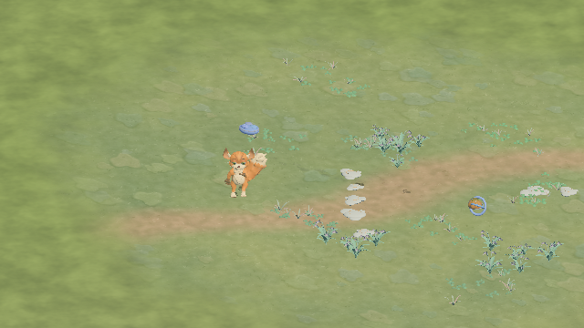
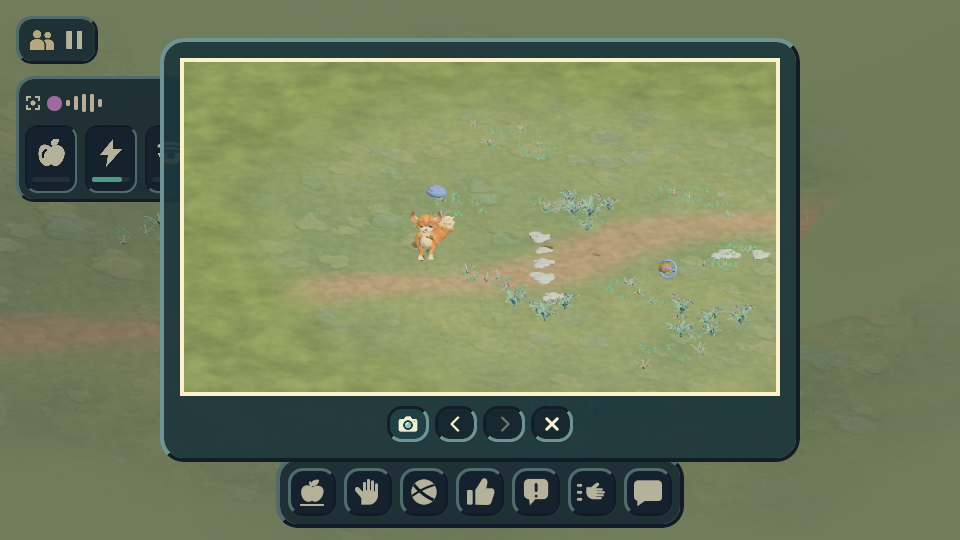

# The field camera

Branch: `qualia/field-camera-20261118`.

The garden, tracks and rattle give the hand things to do. The field camera gives
it a reason to stop doing them. Frame a patch of light, wait for a resident to
walk into it, and keep the moment. Nothing awards a point or causes an organism
to face the lens. A photograph of an empty clearing is a valid result.



## Playing

- The little shutter beside the menu exposes a frame while the world continues
  at its current speed. F5 and the shutter's accessible button do the same.
- **Photos** opens the local collection. Its controls are a shutter, backward
  and forward print arrows, and a return glyph. The shutter can expose the
  current view while the album is open without leaving it or resuming time.
- The indicator is a pale dash while developing, a jade circle when kept and a
  coral square if the exposure could not be kept. The empty frame carries the same camera glyph.
  Gallery controls do not show text. Screen readers get action names, the
  ordinal and size of the current collection, and disabled arrow states.

## What is kept

A disposable 3D lens copies the active play camera into a 640 × 360 field
plate. This is a 16:9 composition through the same lens, not a desktop screenshot:
it deliberately excludes the menu, HUD, pointing Hand and targeting guides. It never opens an operating
system camera. PNG encoding and writing run outside the render thread. No code
publishes or uploads a player's photographs.

The shelf lives in `field-photographs` beside the UI settings. It belongs to
the player, not a world or a lineage. Reopening it shows the newest 48 valid
plates, while older originals remain on disk. Same-timestamp exposures get
separate names; existing files are never overwritten. A new world and a saved
game need no photograph schema or migration.

## Design boundaries

Cassidy asked for a cozy, soft-science-fiction cross between *Black & White*
and *Creatures 3 / Docking Station*, recognizable mammalian creatures, and
function explained visually. The only visible words are the single-word main
menu choices and the existing creatures' own speech. No camera flash, fake
pose, delight, reward, thought, or memory is sent to the residents. This slice
changes player presentation, not simulation, brains, weights, training or
biochemistry. Keep the code at least as clean as it was found.

## Replaying the field route

```text
cargo run --locked -p alife_game_app --features production-voxel-frontend --example field_camera_walk
cargo run --locked -p alife_game_app --features production-voxel-frontend --example field_camera_walk -- --reopen <first-route-output-directory>
```

On Windows debug builds, link the example with
`cargo rustc --locked -p alife_game_app --features production-voxel-frontend --example field_camera_walk -- -C link-arg=/STACK:16777216`
and run the resulting executable directly, as for the rattle route.

The route drives actual production keyboard and accessibility controls and
captures both the local plates and gallery evidence. It checks a moving-world
exposure, a paused exposure, navigation between distinct print handles,
preservation of the paused tick, and playback resumption. The second process
opens the same local shelf without taking another photograph.


## Native evidence

On an RTX 3050 with the detailed island loaded, the first player shutter fired
at tick 152. The print arrived while the world continued to tick 163. After
panning, the second composition was exposed while the menu held tick 169.
Browsing older and newer prints left that tick unchanged; playing again reached
tick 183 on the final replay (184 on the preceding one). A fresh process loaded the existing world and reopened both local
photographs without making a third. Both PNGs contain scene detail and differ
after the pan. Human first-play evaluation remains open.


