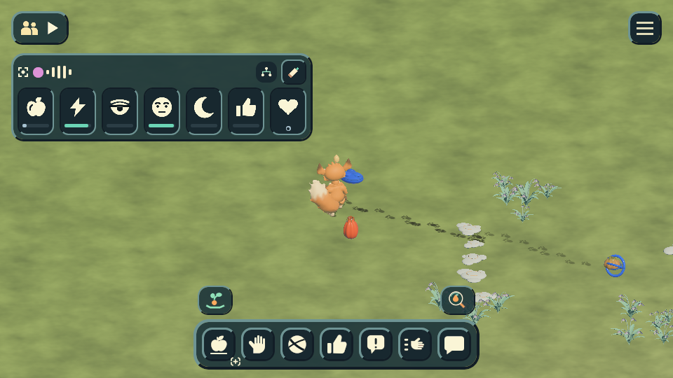
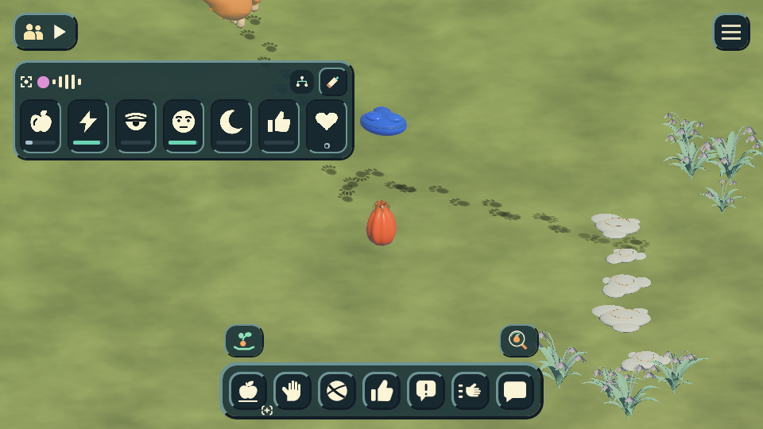
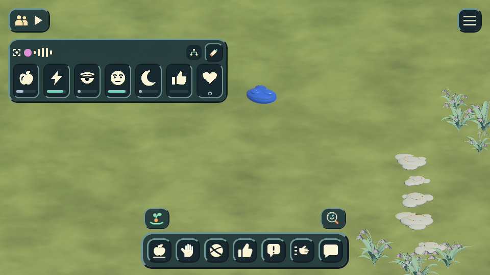
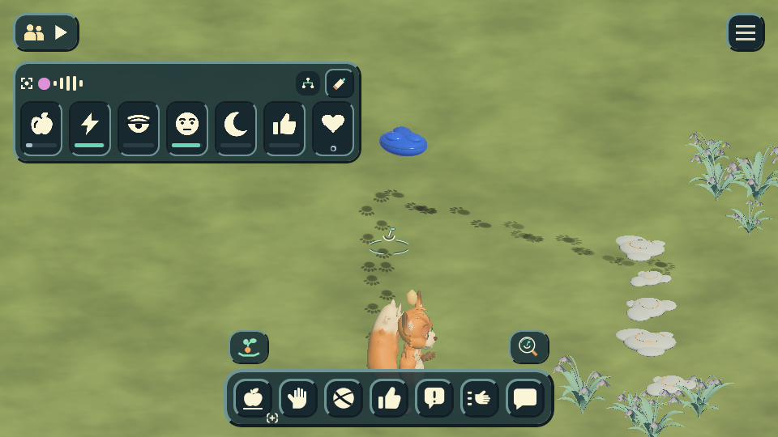

# Qualia: field signs

Branch `qualia/field-signs-20261118` follows the [lantern pear orchard](qualia-lantern-orchard.md). The aim is a cozy, soft sci-fi nursery with the Hand intimacy of *Black & White* and the independent lives of *Creatures 3 / Docking Station*. The original mammalian Hearthling, its Blender mesh, rig and identity are unchanged. No brain, training, weight, learning, biochemistry or world-save code is involved.

## Follow a real trip

Selecting a Hearthling begins a short observation trail. The five-toed sole takes its shape from the approved sculpt. The marks alternate along observed horizontal movement: they illustrate where the individual went, not a recorded skeletal contact, an intention or its next destination. One selected animal leaves at most 36 transient prints. Teleports, off-ground carries, missing samples, impassable ground, a new selection and a world reload do not draw a connecting path. Age is measured in simulation ticks, so a pause does not erase the evidence.



## Return to a gift

The small fieldglass opposite the seed pouch appears only after a real food or toy object is available. Its picture distinguishes food on the ground, a plaything, a gift held by a verified resident and a food object in the world's consumed state. The last state does **not** identify who ate. An unknown, missing or player-held object is not reported as a resident's possession. Reloading a garden can recover a real harvest from its saved ID; a disappearing explicit target does not silently redirect to another gift.

Press the fieldglass or `]` to look. The camera eases toward the physical object, or toward its current carrier, without moving either. A split optical ring briefly marks the spot. For consumed food only, an empty husk appears in the lens, not as a new physical object. Ordinary camera input, a different selection, a modal or a world load interrupts the move. It shares the orchard's camera and accessible Hand-control paths. There is no new HUD text, reward, achievement or compulsory task.



## Evidence and reproduction

On an RTX 3050, the disposable production playthrough recorded 36 prints at world tick 148. The test used the actual accessibility click on the visible fieldglass for physical food ID 8 at tick 164. At tick 198, the 960×540 camera placed that object at (480, 295), 25 pixels from the center. There was exactly one new food object. It was still present, unconsumed and uncarried. The two pictures above are unretouched production frames.

In a second, independent 150-second visit, directly placed food ID 8 already had the world's consumed flag at the first look (tick 174). The same gift was still consumed when revisited at tick 2,090 with one living resident; the view centered it at (480, 298) at tick 2,117. This earlier frame exposed a legibility problem: the camera found the right position, but bare grass did not communicate why.



A third independent run instrumented the published, sealed physical EAT receipts. Its single such receipt named organism 1 and target **2** at tick 10, not the Hand's later gift **8**. Food 8 was still loose on its second inspection at tick 2,556. These are different worlds: the consumed state above does not identify an eater, and neither case is the orchard playthrough. The orchard produced physical pears, but eating a harvested pear was not observed.

On the final optical build, a fourth independent visit did produce a sealed physical EAT receipt at tick **164**, organism **1**, target **8**, the unique new food placed by the Hand. By tick 176 the fieldglass showed its consumed state. The capture at tick 205 shows the empty-husk mark at the actual location, not a replacement food mesh. At 150 seconds the sole resident was still alive and the same gift could be revisited; the camera and husk again marked its recorded position at tick 2,004. This identifies one consumer of one directly placed gift in this run only.



```text
cargo fmt --all -- --check
cargo test --locked -p alife_game_app --features production-voxel-frontend --lib field_signs
cargo test --locked -p alife_game_app --features production-voxel-frontend --lib garden_and_fieldglass
cargo run --locked -p alife_game_app --features production-voxel-frontend --example field_signs_walk
```

Pass `-- --linger` to the Cargo run (or `--linger` to the executable) to return to the resident and look again after 150 real seconds; `sealed_eat` lines retain the tick, individual and exact physical target. The example uses a normal new game on isolated storage, never a player's save or OS-global input. On Windows MSVC use `cargo rustc --locked -p alife_game_app --features production-voxel-frontend --example field_signs_walk -- -C link-arg=/STACK:16777216` and run the binary from the repository root. The raw founding, camera and object evidence is written under `target/artifacts/field-signs/<run>`. Regenerate the transparent pictograms with `python scripts/build_fieldglass_signs.py` and Pillow. A human first-play study and a naturally observed transfer to a second resident remain open.
