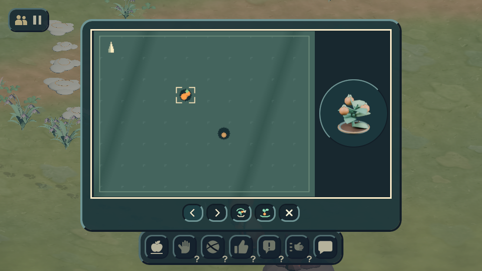
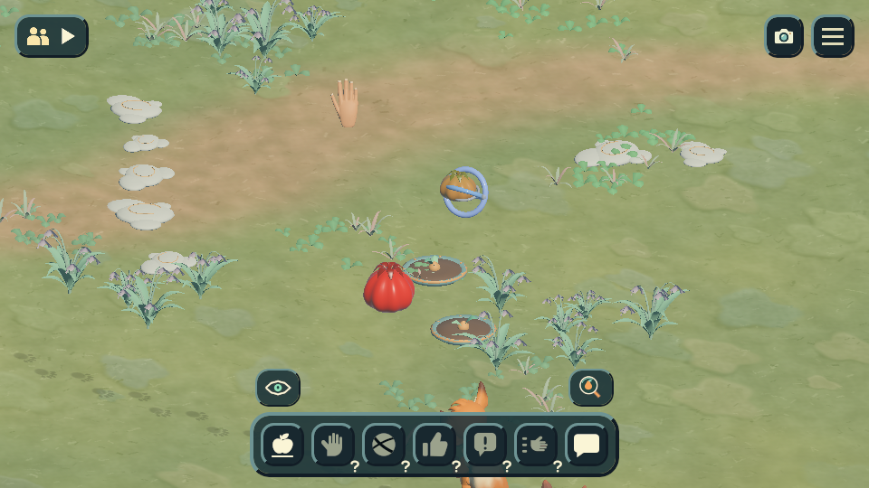

# The garden survey

Branch: `qualia/garden-survey-20261118`, based on the [grounded landmarks](qualia-grounded-landmarks.md) merge `e740cf25`.

A nursery can hold twelve lantern-pear beds. The Hand’s existing return sign
recalls just the latest cycle. The survey lets the player travel between all
the beds they actually planted, including an older ripe plant after starting a
second garden. It does not replace the Hand or decide what the player harvests.

**Garden** opens the survey from the main menu. F6 opens the same instrument
from play. The needle points toward decreasing world Z. The survey samples
the current terrain’s height and slope to draw its relief and contours. Bed
marks use real positions with equal world scale on both axes, not invented
landmarks or travel routes. A seed, pair of leaves, flower or fruit mark records
the current growth stage. The side lens shows the corresponding release mesh
at a fixed scale. A pair of brackets marks the selected bed.

Touch a mark to turn the lens to that plant. The two arrows reach every bed, even if their positions crowd together at island scale. The return-to-garden sign closes the survey
and frames the marked bed; the seed sign frames a legal nearby patch for a new
planting. Neither button sows or picks. Use the pictured Hand tool on the actual
soil. A trip resumes time only if opening the menu paused it. A previously
paused world stays paused. An empty map contains no pretend crop. A world
without residents can still be tended from an existing bed. The map reads the
existing save, stores no duplicate world records and sends no action to a creature.

The reference remains a cozy, soft-science-fiction *Black & White* × *Creatures
3 / Docking Station* with the original mammalian Hearthling. Use only visual
language in play, apart from true creature speech and self-explanatory single-word
main-menu buttons. Keep screen-reader labels, keep touched code clean, and leave
brains, training, learning, weights and biochemistry alone. A ripe bed is not
evidence that its fruit was eaten.

## In the nursery

The RTX 3050 route planted at (84, 251), waited for real fruit, then planted a
second bed at (85, 252). The two beds appeared at tick 467 as ripe and seed.
Both arrow navigation and pressing the fruit mark with the pointer changed
which bed the lens showed; neither changed the paused tick or moved the Hand.
Visiting the older bed resumed play. A separate harvest gesture produced one
physical food object, ID **8**. The next trip returned to the younger bed at
tick 504. This records a harvest, not a meal or an identified eater.

A second run confirmed the save path too. The first, flawed check exited when
the pre-existing seed file was present, before the manual checkpoint finished
publishing. The route now waits for the checkpoint receipt and verifies the
canonical file contains both beds and the picked fruit. A fresh process opened
that published tick **516**, found both beds, visited (85, 252), and resumed to
tick **542**. It did not plant either bed again.

Both images are unretouched game frames, not the Blender specimen assets.
This test uses the actual player input paths; a human first-play comprehension
study is still open.

## Reproduction

- `blender --background --python scripts/render_garden_specimens.py` makes the four original specimen plates directly from the game's garden GLBs.
- `cargo test --locked -p alife_game_app --features production-voxel-frontend --lib` covers zero-resident save/restore, stage truth, coordinate projection, input gating and native UI hit bounds.
- `cargo run --locked -p alife_game_app --features production-voxel-frontend --example garden_survey_walk` drives the native game, plants two beds, switches between them and harvests the older one. A numeric run argument reopens only its own disposable save under `target/artifacts/garden-survey`. On Windows debug builds, use `cargo rustc --locked -p alife_game_app --features production-voxel-frontend --example garden_survey_walk -- -C link-arg=/STACK:16777216` and run the linked executable from the checkout root.
