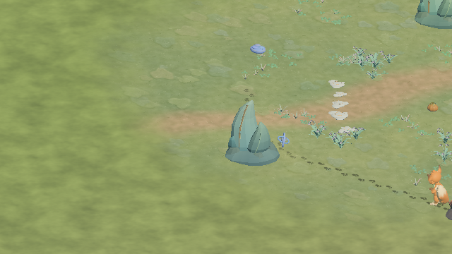
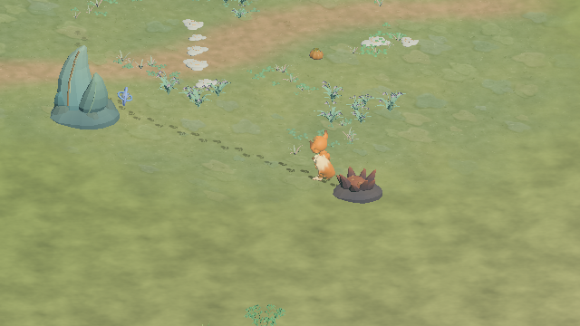
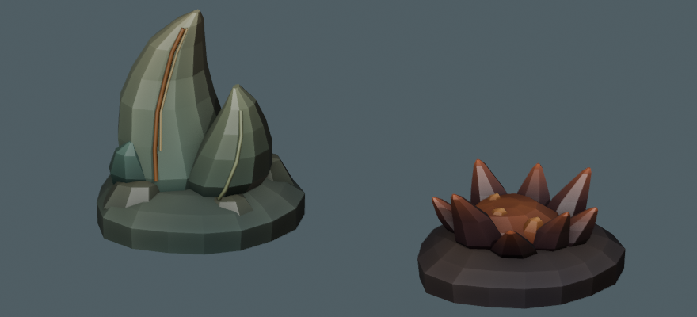

# The real edges of the nursery

A rattle could stop in what looked like empty grass. The canonical seed-1643
nursery actually contains two physical obstacles and a hazard. Care placement
and the rolling ball already respected the blocking bodies. The live player
view drew the food and toys, but had no display body for those three objects.
Terrain-pressure dressing is not a substitute for an object's true position.



## Reading the ground

A **waykeeper** is a fork of weathered celadon mineral with a thin copper vein.
Its wide, pale upright and broken shoulder distinguish it from a collectible
ball or a chime table. A much lower, darker **emberstone** has a broken fan of
warm-tipped shards. Neither appears just because a place looks empty:
exactly one form is projected for each visible, unconsumed obstacle or hazard.
Partial optical opacity stays translucent; intentionally invisible bodies stay invisible.
A physical body's coordinates, radius, heading, color, roughness and shape
supply the placement and variation. Reloading, moving or removing the body
changes the view. There is no new collider and no effect on the inhabitants.



## Art and replay

The editable [Blender source](../crates/alife_game_app/assets/care/landmarks/landmarks.blend)
contains both original works. Each shipping GLB is one vertex-colored primitive, with 1,210 triangles for the waykeeper and 1,022 for the emberstone. Both together are under 140 KB.


Both have a normalized, partly buried shoulder around the physical footprint;
the sharper mineral fan and tall fork read differently even without color.

```text
blender --background --factory-startup --python-exit-code 1 --python scripts/build_sanctuary_landmarks.py
python -m unittest scripts/test_sanctuary_landmarks.py
cargo run --locked -p alife_game_app --features production-voxel-frontend --bin alife_game_app -- validate-production-assets
cargo test --locked -p alife_game_app --features production-voxel-frontend --lib landmarks
cargo run --locked -p alife_game_app --features production-voxel-frontend --example landmark_walk
```

The Windows debug Bevy example needs the same 16 MiB main stack as the
production executable: `cargo rustc --locked -p alife_game_app --features production-voxel-frontend --example landmark_walk -- -C link-arg=/STACK:16777216`.
Run that binary from the repository root. The route reads the canonical
new game, uses keyboard camera navigation and ordinary aim-and-release Hand
gestures, and writes evidence only into its isolated run directory.

In the integrated RTX 3050 route the first drag left 0.8446 m between the
ball and the real body boundary. A second drag of the same meadow ball stopped
at the summed physical radii by tick 289 (less than 0.001 m clearance). It stayed
parked while the camera moved. The live field shutter made the two plates above
from that run. The nearby resident is visible, but that does not establish any
injury, reaction or intention.

This branch is `qualia/truthful-landmarks-20261118`. Cassidy's direction
remains a cozy soft-sci-fi *Black & White* × *Creatures 3 / Docking Station*,
expressed through visual language. The only visible words are the one-word
main-menu choices and the inhabitants' own speech bubbles. Keep the mammalian
Hearthling, minds, weights, learning and biochemistry intact. No authored pose,
fake injury, change in world rules or gameplay instruction text is added here.
