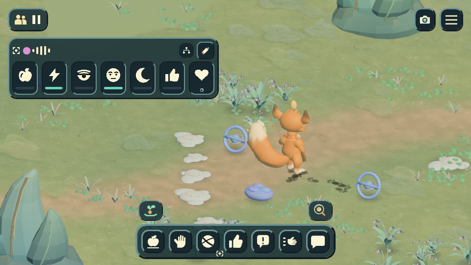

# At ground level

A pear, rattle and chime table used to share one 30 cm vertical offset. On the nursery's authored meshes a small loose pear could therefore sit nearly 14 cm above its own physical origin. Photographing a previously harvested pear exposed the discrepancy: the object and bowl barely seemed to touch the same patch of earth.

The optical center for the Hand, picking and art now uses the shipped mesh's resting depth and the individual body's shape. A real grip retains its previous attachment offset. The rattle's ring is not a perfect sphere; this is its neutral support height, not a second physics simulation. Neither a canonical elevated position nor any physical color is changed.

A soft dark edge under actual keepsakes, bowls, silverbell drifts and ceramic waystones follows the slope of the rendered soil. Each print leaves with its source. A creature's grip, a body distinctly above or below the ground, or missing ground leaves no contact print. The normal habitat and field camera also apply the same single-pass edge smoothing; the minimum profile keeps it disabled.

Branch: `qualia/groundlight-20261118`. This is a display treatment within Cassidy's wordless, cozy soft-sci-fi Black & White × Creatures 3 / Docking Station direction. The selected Hearthling, all biology, brains, learning, training and weights are unchanged. No new onscreen text.

## In the native renderer

On an RTX 3050, the real Hand placed a rattle in a new seed-1643 nursery. Two unretouched exposures below are at the same paused world tick **49**, with the same camera and 26 near-soil sources. Compare the shadow under the right rattle, the undersides of the stepping stones, and the thin grass above the resident. Time-based selection optics can still fade while paused. No change to the resident’s behavior is implied.




In a second unmodified play session, the pointer rolled a real rattle into its table and the accessible return produced another visible strike at tick 151. A third native session exposed two different field photographs, reopened the older plate, and resumed play at tick 186. The saved plate is the habitat, without the Hand or HUD.

## Reproduce

The opt-in `groundlight_study` example opens a disposable native game and pauses the world for a matched comparison. Its comparison controls affect only the visibility of the shade meshes and the camera's edge smoothing. Both photographs already use the corrected physical-art alignment. A change in brightness is not evidence of an organism's response.

```text
cargo test --locked -p alife_game_app --features production-voxel-frontend --lib production_voxel_renderer::groundlight
cargo test --locked -p alife_game_app --features production-voxel-frontend --lib production_voxel_renderer::live_food_projection
cargo run --locked -p alife_game_app --features production-voxel-frontend --example groundlight_study
```

For Windows debug builds, use `cargo rustc --locked -p alife_game_app --features production-voxel-frontend --example groundlight_study -- -C link-arg=/STACK:16777216` and launch the resulting binary in the checkout.
