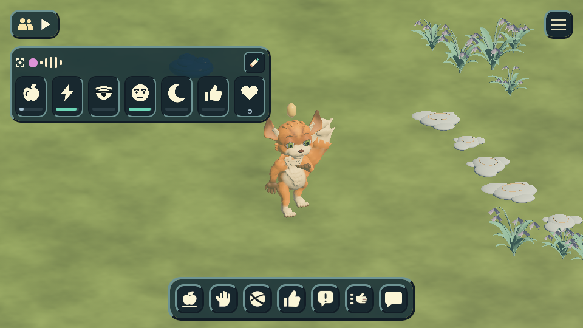
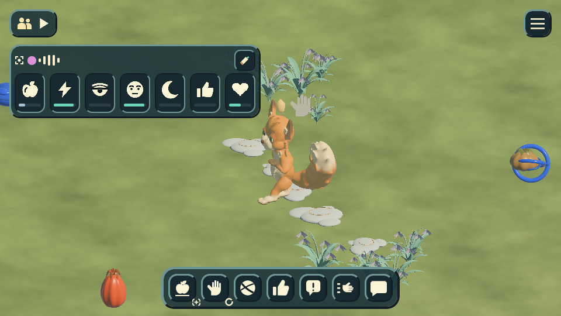
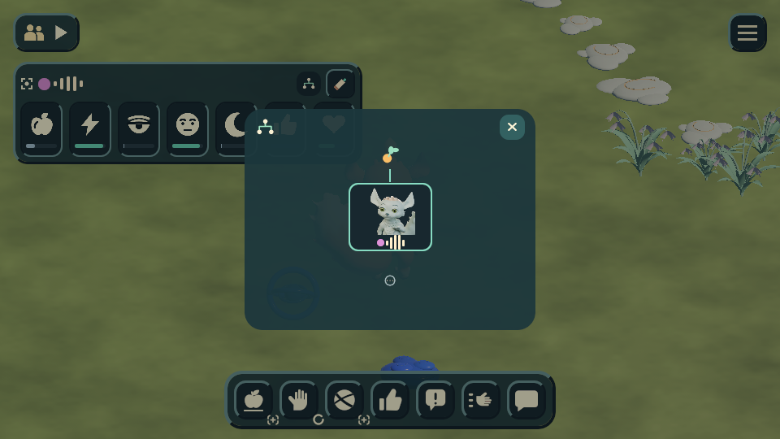
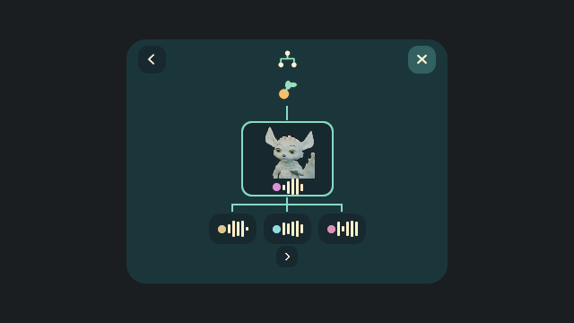

# Qualia: the Lantern Garden

## Direction and limits

The reference is the relationship with a creature in *Black & White* and the tactile nursery of *Creatures 3 / Docking Station*, in a cozy, soft science-fiction world. This is a production slice, not a claim of AAA polish. Preserve the selected, cute mammalian Hearthling, its rig and its body language. Aim for craft and clarity: a touched system should leave less duplication behind, not a new overlapping convention.

The ordinary game teaches with silhouettes, motion, light and repeated pictograms. Visible words belong only to actual creature speech bubbles and self-explanatory, single-word main-menu buttons. Screen-reader descriptions stay intact. Diagnostics and the textual lineage laboratory require an explicitly developer-enabled launch; the player-facing family album uses neither its keyboard commands nor its text.

Do not use this branch to adjust biochemistry, cognition, neural weights, training, or the learning policy. Do not simulate success because the Hand asked for something. Unknown evidence stays unknown.

## What the player can do

* Notice: meet the Hearthling under the amber focus lantern. The selected individual's crest is stable across sessions; the quantity chips distinguish absent evidence from a measured zero.
* First touch: after a living creature is selected, a brief focus-to-hand pictogram points to the gentle stroke. The invitation retires when the player tries care, or after a quiet interval. F1 recalls it without opening a text manual. A queued action is never presented as a creature response.
* Approach: select a live creature and scroll closer. The field camera blends into a three-quarter portrait, keeping its entry angle so real turns remain visible rather than spinning the camera. Point the Hand and right-click once to stroke the individual under it. Positive and negative interactions remain separate, deliberate actions. Holding the button never queues repeated pets.
* Offer: aim at ground to place the orchard fruit, or select a creature to offer fruit just ahead of its gaze. An explicitly blocked location is not silently changed. A creature-directed offer seeks a nearby, walkable alternative. The real food and toy belong to the world, not the renderer.
* Play: place the orbital rattle near a creature and leave the outcome up to the creature. A dropped prop, a requested touch and consumed care are different events. Consumed care has an action-shaped glyph and bodily response; it never generates pretend dialogue.
* Communicate: tap grounded word pictograms, select an addressee or broadcast, and send through the existing speech channel. Only actual utterances anchor to the live creature. Typed input and assistive names remain available.
* Return: familiarity records an individual's history of consumed player care. It decays over simulated time, persists through save/load and colors the presentation of an existing rest pose. It is **not** a new neural input or hormone.

* Meet the family: open the branching icon beside the selected crest, or press Y. The porcelain Hearthling cameo marks the focal individual; its color and five-bar crest match the HUD. Follow a crest upward to parents or downward to children. A seed marks a founder, a hollow mark denotes a missing record, and a memorial sprig marks a deceased relative. Tab/Shift-Tab and Enter/Space activate the same controls as a pointer or assistive click. Arrow keys navigate, Backspace retraces visits, and Escape returns to the garden.

The album is a read-only snapshot of the world's organism registry. A recorded parent genome points to a particular individual **only** when exactly one older resident record carries it. Shared, missing and future individuals do not become invented parents; unrecorded children are not implied. The neutral cameo is a shared species illustration, not a claim about an individual’s coat. Regenerate it from the approved mesh with `blender --background --python scripts/render_hearthling_cameo.py`; `python scripts/build_kinship_signs.py` regenerates the other original signs.

## Integration

Branch: `qualia/lantern-garden-20261118`, based on `52badd43`. Compared the actual combined Argon branch `argon/brain-and-game-improvements-20261110` (`eacb100d`), including its merge of Muse `bob/soul@f08b7755`, against current main. Kept main's working carry/camera, load-identity and monotonic-care-receipt fixes; brought over Muse's presentation/save slice, not either branch's research paths. In particular, an old or missing care receipt cannot stand in for an observed reaction.

The original Lantern Garden landed via [#402](https://github.com/BobertNeek/A-Life/pull/402) at `abfeb837`. The first-touch and recorded-kinship follow-up is `qualia/kinship-garden-20261118`, based on that merge; it reads identity metadata without editing any organism or genome.

The island nursery has three sculpted silverbell drifts and brass-inlaid ceramic stepping stones grounded on the actual terrain. They stay there when a creature leaves. An immediately available coarse mesh samples the real island while its detailed meshes stream, so the opening no longer puts a creature over empty blue.

Art source, release meshes and a Blender material study live in [assets/care](../crates/alife_game_app/assets/care). Rebuild the native scene and glTF meshes with `blender --background --python scripts/build_care_keepsakes.py`. A material study is not a screenshot of gameplay. In-game colors derive from the world object's appearance; visual assets never own selection, placement or effects.

## Verified in the real game

On an RTX 3050, the disposable GPU-authoritative game reached the nursery, accepted an offer and pet, showed the applied-care glyph, offered the toy and opened the composer. The frame metadata identifies the live individual and records the world responses. The creature can turn away; the camera does not choreograph it. These are unretouched in-engine frames, not Blender stills.









The [lantern pear orchard](qualia-lantern-orchard.md) carries the Hand into a persistent sowing, harvesting and offering loop. Its crops are world objects, not creature training.

## Checks and remaining work

```text
cargo fmt --all -- --check
cargo test --locked -p alife_world --test canonical_new_game player_familiarity
cargo test --locked -p alife_game_app --features production-voxel-frontend --lib production_voxel_renderer
cargo test --locked -p alife_game_app --features production-voxel-frontend --lib production_conversation_lineage_ui
cargo test --locked -p alife_game_app --features production-voxel-frontend --lib capture_family_navigation_using_real_accessibility_actions -- --ignored --nocapture
cargo run --locked -p alife_game_app --features production-voxel-frontend --bin alife_game_app -- validate-production-assets
```

Use the optional `lantern_garden_playtest` example for a real, GPU-required 960×540 smoke playthrough. It starts a **new** seed under a fresh artifact directory, captures frames of a normal menu dismissal, offering, petting, play, conversation, the album and return to the garden, and never injects keyboard input into another application. On Windows MSVC the production loader needs a 16 MiB main-thread stack: build the example with `cargo rustc --locked -p alife_game_app --features production-voxel-frontend --example lantern_garden_playtest -- -C link-arg=/STACK:16777216`, then launch the example binary. Check the screenshot before claiming an interaction was completed; queued care and an observed response are distinct.

The optional graphical pedigree test feeds normal accessibility click requests to the production album. It visits a parent, pages a set of four children and opens a child; it never injects those fixture individuals into a real world.

A human first-time-player study, a physical assistive-device pass and a long-session playthrough with real born descendants are still needed. They cannot be inferred from a screenshot or fixture.
