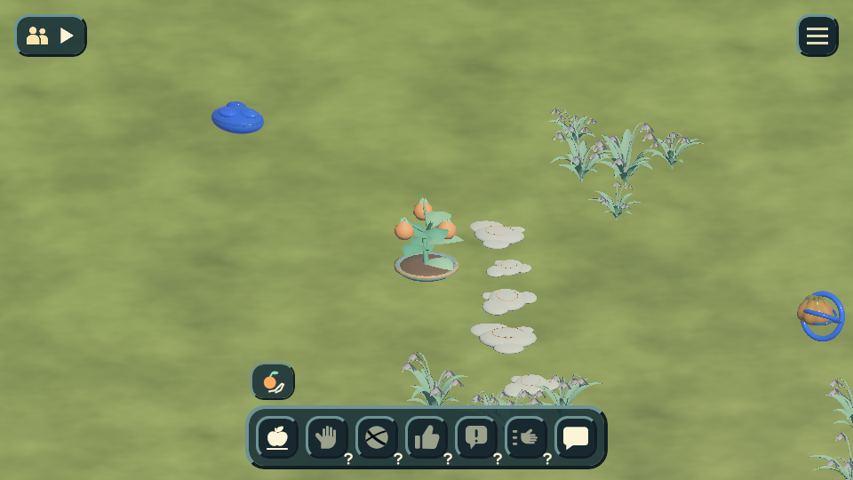
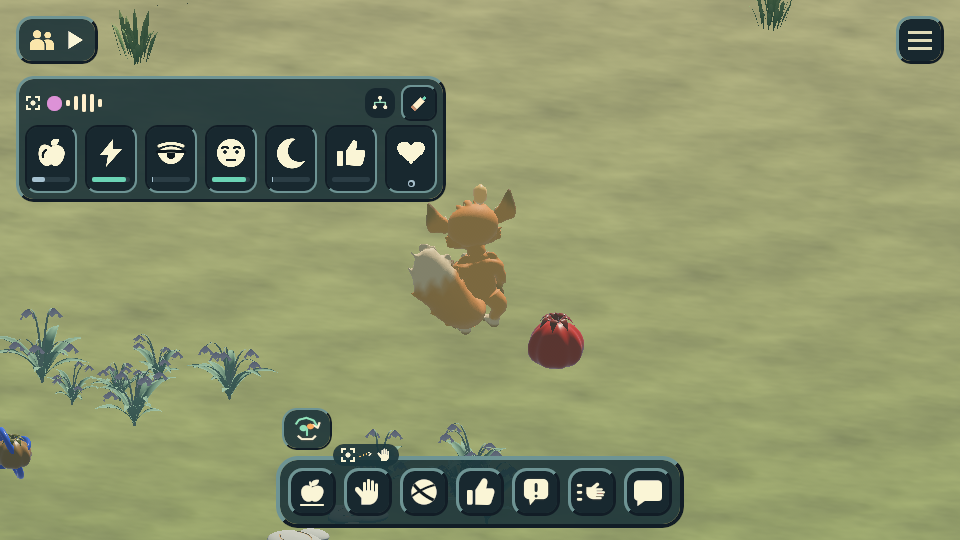
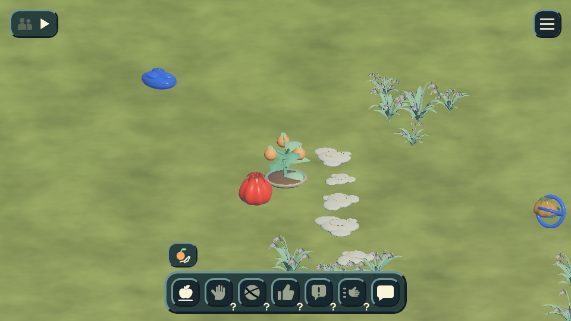

# Qualia: lantern pears

Branch: `qualia/orchard-watch-20261118`, based on `d85c2efe` after the [Lantern Garden and family album](qualia-lantern-garden.md).

The garden is a place to do something together, not a quest list. The brief is the Hand and creature relationship from *Black & White*, the tactile nursery of *Creatures 3 / Docking Station*, and cozy soft science fiction. Preserve the original mammalian Hearthling. Teach with things a player can see: folded leaves change into cream flowers, then hanging amber pears. No tutorial text, timer, score or inventory list. The only ordinary on-screen words belong to genuine creature speech and single-word main-menu buttons. Assistive labels are not visible captions. Keep touched code cleaner and respect the hard boundary: this feature neither inspects nor changes creatures’ brains, learning, weights, training or biochemistry.

## Working the garden

- The small seed pouch sits above the Hand. From a resident, use it to choose soil. A jade ring marks a valid tile. Click to sow, or move the marker with arrow keys and confirm with **U**. Touch the pouch again to retract the Hand. Selecting an empty patch directly also offers sowing. Opening another panel releases the tool.
- Watch the new bed through four distinct silhouettes. The rain pictogram offers one watering after the first leaves appear. Dry plants ripen without help. A deliberate watch or return gently frames the plant; camera input gives the view back to the player.
- The pick pictogram drops a real, loose food object at a clear neighboring spot and the bed begins another cycle. If every neighboring spot is occupied, a ripe plant waits. With a living resident selected, a pictured pear can be brought from a nearby harvest to a clear spot within reach. This moves that same object; it creates no new food and does not order the creature to eat or simulate gratitude. The return pictogram goes back to the most recent bed.
- A world can have up to twelve beds. Seed, water and harvest times are simulation ticks, not wall time. Beds, the last harvested object's identity and whether it was offered are part of the world save. An old world without beds does not acquire an empty serialized field. The render layer reads the world; it cannot grant a harvest.

## What happened in the game

A five-minute RTX 3050 run used production controls from a fresh, one-resident world (seed 1643). The tester planted and watered, picked fruit **8**, selected the resident, brought that same fruit to **1.39 world units** away, then used the return sign and picked fruit **9** from an unwatered cycle. Both objects were still in the world and unconsumed at **300.5 seconds / tick 4,931**. The absence of eating is a finding, not a failed completion rewritten as a reward.





Both are unretouched production screenshots. The first test run had the camera follow the resident away from the crop; a later one could not find the crop again after offering the fruit. These observations led to the planting camera and return control. No human first-time comprehension study or multi-generation playthrough is implied.

## Assets and reproduction

The [Blender source and four release meshes](../crates/alife_game_app/assets/care/orchard) share a glazed bowl, brass rim, loam and folded leaves. Rebuild with `blender --background --python scripts/build_lantern_orchard.py`. Rebuild the six font-free Hand images with `python scripts/build_orchard_signs.py` (Pillow). Refresh the production asset manifest's digests when changing a release GLB.

```text
cargo fmt --all -- --check
cargo test --locked -p alife_world --lib headless::orchard
cargo test --locked -p alife_game_app --features production-voxel-frontend --lib
cargo run --locked -p alife_game_app --features production-voxel-frontend --bin alife_game_app -- validate-production-assets
cargo run --locked -p alife_game_app --features production-voxel-frontend --example orchard_watch
cargo run --locked -p alife_game_app --features production-voxel-frontend --example orchard_resume -- NUMERIC_RUN
```

The examples require a real GPU. On Windows MSVC, build each example with `cargo rustc --locked -p alife_game_app --features production-voxel-frontend --example NAME -- -C link-arg=/STACK:16777216`, then launch it from the repository root. `orchard_watch` writes screenshots, receipts and its own disposable save under `target/artifacts/orchard-watch/<numeric run>`. `orchard_resume` accepts only such a run, never a player-save path. No OS-global keyboard or mouse input is sent.

## Longer sessions

The first solo resident disappeared from this run before five minutes. The final autosave contained neither a living agent nor an organism record. The production frontend previously rejected that valid zero-resident save. It also compared unspecified populations against the graphics profile default, passed a scenario template's seed to the loader and could choose an older cached checkpoint. Here the older checkpoint was at tick 942 with one resident; the newer source was at tick 1,807 with none. A saved garden should not need a made-up founder. Load now uses the saved roster when unspecified; explicit mismatches, profile caps, malformed saves and zero-founder New Games remain invalid. Population capacity is distinct from occupancy. Two independent RTX restores checked both outcomes. The final empty save retained tile (79, 251) and fruit 9 with zero residents at tick 1,974. Loading an occupied save retained its single original resident and fruit 9, still available to offer at tick 1,104. The normal return control found the bed without selecting a synthetic creature. The profile directory scopes writable saves; a canonical world in that directory keeps its durable generation journal when reopened. An empty scene activates visible terrain around the newest bed, then falls back to a saved resource or the origin. Both the occupied and empty roster cases belong in regression coverage.


