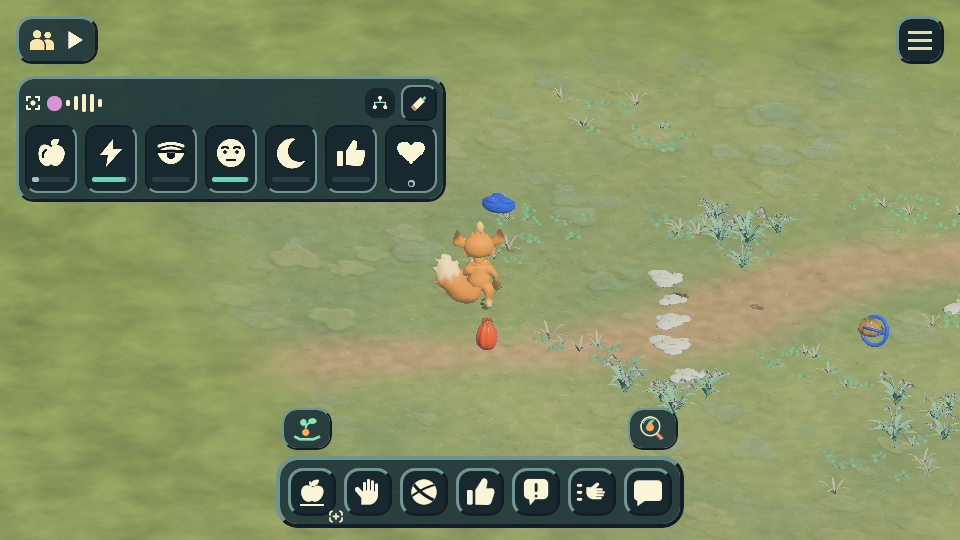
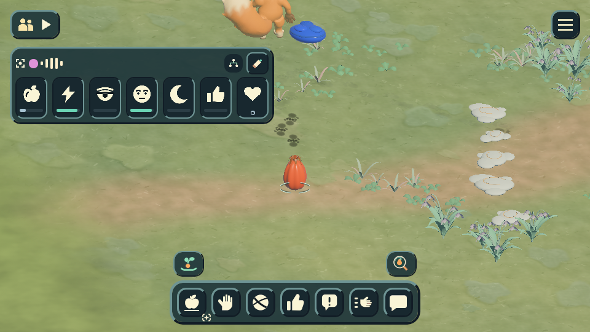

# Qualia: the nursery floor

The [fieldglass playthrough](qualia-field-signs.md) made one art problem plain: at the scale of a Hearthling, most of the nursery was a single soft olive surface. The new floor is fixed to that clearing, not to a character. An earthen seam weaves past the ceramic waystones. Sage and celadon moss break up its edges, with folded moon sorrel and shell-pink ribbon grass gathering in short drifts. The center is open for the Hand, fruit, and five-toed prints. Nothing here is a new pickup, obstacle, feeding cue or speech bubble.



## In play

These are unretouched 960 × 540 captures from a normal RTX 3050 new game. Once all 120 island chunks had loaded, the camera followed the resident and its 36 tracked impressions at tick 167. At tick 179 the Hand's fieldglass was clicked for the newly placed food, ID 8. At tick 204 the same object was still loose and centered at (480, 295). Compare with the [older close-up](media/field-signs/real-gift.png). No meal was observed for this gift in this run; a separate playthrough of the previous slice [did independently identify one](qualia-field-signs.md).



## Source and constraints

Branch `qualia/nursery-understory-20261118`. The editable [Blender scene](../crates/alife_game_app/assets/care/nursery/understory.blend) includes its packed ground painting. The whole clearing exports as three primitives (15,584 triangles, one embedded 1536² texture). Its base follows the immutable island's original 8 × 8 near-mesh cells and diagonals; the wash sits 4 mm above ground, below the 11 mm footprint mark. The foliage does not cast shadows or intercept picking, and the fixed scene is removed with the loaded world. Neither the island heightfield nor creature geometry, brains, training, weights, learning, or biochemistry changed. No new onscreen text.

To rebuild, run `python scripts/paint_nursery_floor.py`, then Blender 5.2.1 LTS with `--background --factory-startup --python-exit-code 1 --python scripts/build_nursery_understory.py`. Refresh the understory entry in the production asset manifest if the GLB changes, then run:

```text
python -m unittest scripts/test_nursery_understory.py
cargo run --locked -p alife_game_app --features production-voxel-frontend --bin alife_game_app -- validate-production-assets
```

The export tests inspect the shipping GLB for terrain registration, transparent borders, draw budget and packed texture. The art is nursery-only; the wider island, camera composition and first-time player legibility remain separate work.
