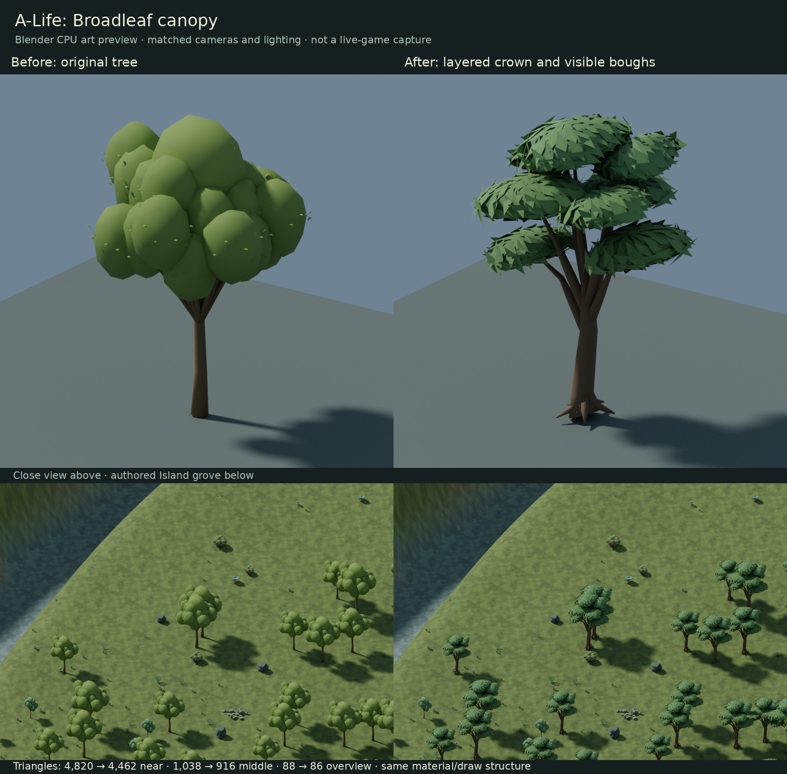

# Broadleaf canopy replacement, 2026-10-16

Status: draft visual improvement. This report certifies the files named below,
not architecture compliance, gameplay acceptance or physical-GPU performance.

## Visible change

The old Broadleaf's smooth, near-spherical olive clusters are replaced by an
asymmetric layered crown. Eight unequal scalloped leaf fans expose curved
load-bearing boughs and daylight gaps. The trunk forks and has a buttressed
base. Opaque folded leaves give the near view a legible foliage surface without
alpha cards or textures. Middle LOD uses solid scalloped envelopes rather than
enlarged sparse leaf blades. The overview is a bounded crown-hull reduction.

The first, more conservative candidate retained an excessively rounded crown;
it was rejected during review. A sparse-card middle LOD was also rejected and
replaced before the delivered candidate. Final L0 was checked from opposite
sides. An independent visual review accepted the revised grove and final middle
LOD for a draft, with pointed leaf edges/dark creases as optional style polish.

## Matched evidence



Left is the exact pre-pass Broadleaf from main `69f00c0`; right is the candidate.
Lighting, camera, resolution, ground and authored grove transforms are matched.
The grove uses the actual Island terrain and nearby authored prop placements,
including 45 Broadleaf instances in the bounded render region. It is a Blender
Cycles CPU material review, not a live-game screenshot or timing measurement.

Reproduce full-size close L0/L1/L2 and reverse images with:

```sh
blender -b -t 4 --factory-startup --python-exit-code 1 --python scripts/render_broadleaf_canopy.py -- --asset crates/alife_game_app/assets/landscape/island/Broadleaf.glb --output target/artifacts/broadleaf-canopy/final
blender -b -t 4 --factory-startup --python-exit-code 1 --python scripts/render_broadleaf_canopy.py -- --asset crates/alife_game_app/assets/landscape/island/Broadleaf.glb --output target/artifacts/broadleaf-canopy/final --grove
```

For the matched baseline, replace the asset path with
`crates/alife_game_app/assets/landscape/island/broadleaf-canopy/Broadleaf.baseline.glb`.
The renderer disables unavailable OpenImageDenoise support and uses 48 samples.

## Cost and preserved contracts

| Property | Baseline | Candidate |
| --- | ---: | ---: |
| Near triangles | 4,820 | 4,462 |
| Middle triangles | 1,038 | 916 |
| Overview triangles | 88 | 86 |
| Near exported vertices | 4,042 | 4,675 |
| Runtime GLB bytes | 184,640 | 183,108 |
| Materials / primitives per LOD | 1 / 1 | 1 / 1 |
| Textures / alpha blending | 0 / none | 0 / none |

Fewer triangles do not prove a rendering-speed gain: near exported vertices
increase by 633 because of the folded leaf surfaces and shading boundaries.
No new instances, material switches, textures, custom shaders or draw primitives
are introduced. The existing shared opaque, double-sided painted material is
unchanged. Three ground-centred named LODs and exact 6 x 5.5 x 8 metre dimensions
remain. The runtime file shrinks by 1,532 bytes.

The fixed successor profile audits every art/world file, retains all unrelated
bytes and all 47 other complete manifest records, and checks this single
registration's digest, size and updated generator provenance. Original
multi-asset Blender sources, terrain/props/proxies, Highlands, hand, Hearthling,
physiology, cognition, save/load and runtime rendering code are unchanged.

## Verification and limits

- Focused GLB checks cover finite geometry, unit normals, valid nondegenerate
  triangles, normalized byte colors, opaque shared material, node/mesh names,
  identity transforms, ground origin, bounds and per-LOD triangle ceilings
- Four 96-pixel geometric silhouette views measure near-to-middle coverage
  86.8–94.1% and intersection-over-union 78.2–88.9%; near-to-overview coverage is
  88.1–95.1% and intersection-over-union 77.3–83.5%
- These silhouette scores expose simplification; they do not prove invisible
  popping. Middle deliberately loses fine leaf texture. Live engine orbit/zoom,
  shadow and normal-distance transition checks remain unrun
- Normal source reload/re-export reproduces the shipping GLB byte-for-byte;
  the separate native source is included so artist edits remain possible
- The original fixed consolidated/conifer validators and profiles are retained;
  their older whole-tree snapshots intentionally do not certify this new art

Run the candidate successor and general shipping contracts with:

```sh
python scripts/check_broadleaf_canopy.py --output target/artifacts/broadleaf-canopy/check.json
python scripts/check_island_art.py
python -m unittest discover -s scripts -p test_broadleaf_canopy.py
bash scripts/docs_check.sh
git diff --check
```

No production cognition or renderer Rust code changed. Full workspace Rust,
live-game playtests and RTX 3050 GPU/FPS qualification are not claimed.
