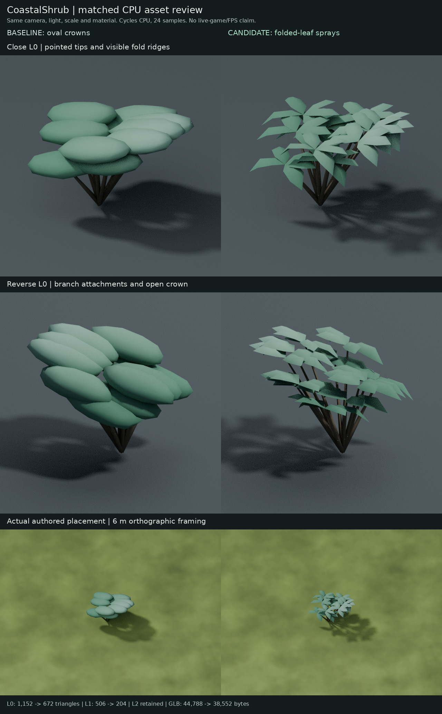
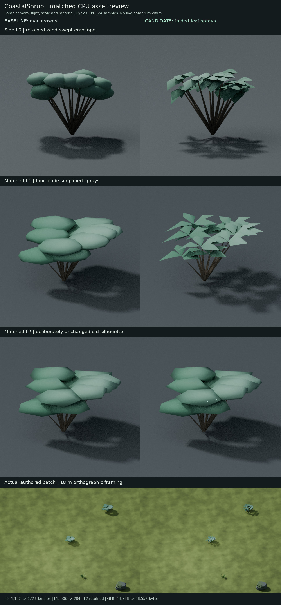

# CoastalShrub folded-leaf sprays, 2026-10-16

Status: draft art implementation with independently approved exact prototype
bytes. Based independently on main `73f8ecf03a4bbd90018c0fae7c732c6ec488e1d9`.
This report certifies the named source/runtime files and bounded offline checks,
not live-game acceptance, organism architecture compliance or GPU performance.

## Visible change and review

Twelve smooth oval crown pads become compact wind-swept sprays. L0 has five
pointed folded blades per crown; L1 has four simpler blades. The existing radial
stems, their exact branch attachments and sea-glass palette are retained. The
new foliage is angular, airy and slightly papery. Inspected close/reverse views
show distinct tips, ridges and crown gaps without visible protruding branch tips.
The first prototype's generic envelope fit exposed branch tips in reverse view;
the delivered piecewise mapping fixes every blade root to its original branch
attachment while retaining each crown's six extrema.

An independent prototype review accepted the exact GLB/native hashes below for
further game-art review, with explicit live-transition limitations. L1 is flatter,
sparser and more arrow-like than L0. At a real 6 m authored framing, pointed
foliage remains legible; at 18 m its effect is mainly finer edges and shadows.
This is a close-range character improvement, not a large long-distance visibility
gain or final art-direction approval.





These are actual imported baseline/candidate GLBs, matched orthographic cameras,
lights, material, scale, Cycles CPU 24 samples, no denoising, AgX. Real-patch
views use the independent main-based branch's terrain, actual placements/yaw/
uniform scale and current near-triangle plant grounding. They were regenerated
after integration, so they contain no unmerged Fern art. The patch framing is
6 m/18 m wide; it is not a statement about the live game's projection.
Source hashes, cameras and sampled placements are in the adjacent render receipts.

## Measured cost

| LOD | Baseline triangles | Candidate triangles | Baseline exported vertices | Candidate exported vertices |
| --- | ---: | ---: | ---: | ---: |
| L0 | 1,152 | 672 | 624 | 600 |
| L1 | 506 | 204 | 307 | 276 |
| L2 | 218 | 218 | 163 | 163 |

GLB size: 44,788 to 38,552 bytes, a 6,236-byte (13.92%) reduction.
L0/L1 triangles decrease 41.67%/59.68%. Counts include actual normal/color
splits. One primitive per LOD, one unchanged shared material, normalized U8 RGB
colors and no texture/shader additions remain. These are geometry/file-size
measurements, not FPS or GPU-timing results.

## Preserved contracts

- Exact original per-LOD AABBs, including inherited small L1/L2 differences
- Ground-centred native/runtime origin, identity exported transforms, exact
  `CoastalShrub_L0/L1/L2` mesh/node names and scene bindings
- Original stems' native polygon-corner positions and colors; all 60 L0 and
  48 L1 blade roots coincide with original branch attachments
- Opaque open double-sided blade surfaces. They meet stems geometrically and
  are not topologically welded or watertight
- Every L2 vertex attribute and index is retained exactly
- Historical two-species native source and BerryBush bytes remain exact.
  Exporting BerryBush from the new source independently reproduces its runtime
- All 170 shrub placements, all other placements, collision, terrain, other
  art/world bytes, creature state and runtime selection code remain unchanged
- Only the CoastalShrub registration's digest, size and generator provenance
  change; the other 47 manifest records remain exact

The new editable source intentionally retains the approved prototype's exact
bytes, including its historical prototype custom-property text. It contains the
unchanged BerryBush meshes for retention auditing, but the production exporter
selects only CoastalShrub.

## Ownership, reproduction and checks

Current source: `crates/alife_game_app/assets/landscape/island/CoastalShrub.leaf-sprays.blend`,
Blender 4.3.2. The original `island-biological-shrubs.blend` stays byte-retained
and continues to own BerryBush. Its exporter writes both species, so apply the
new shrub exporter last after any historical override/base-library rebuild.
The exact prior runtime is retained under
`coastal-leaf-sprays/CoastalShrub.baseline.glb`.

```sh
blender -b -t 4 --factory-startup --python-exit-code 1 --python scripts/build_coastal_leaf_sprays.py
python scripts/register_approved_art.py
python -S scripts/check_coastal_leaf_sprays.py
python -m unittest discover -s scripts -p 'test_coastal_leaf_sprays.py' -v
python scripts/check_island_art.py
blender -b -t 4 --factory-startup --python-exit-code 1 --python scripts/check_coastal_leaf_sprays_native.py
```

Normal export reloads current native edits without resaving/reapplying authoring,
and writes only CoastalShrub GLB. `-- --output-dir <directory>` supports a clean
export elsewhere. Optional `-- --author` reconstructs from the pinned historical
native source; it was tested in a separate reproduction tree and produced the
exact reviewed GLB. Both export flows resolve paths from the repository, not an
executor-specific checkout or current working directory.

The new fixed successor pins the complete art/world path, byte and mode set,
source recipes and imported helpers, exact specification changes and all 48
manifest entries. Standard-library positive/negative tests cover geometry,
bindings, retained sources, placements, metadata and unrelated asset retention.
All 49 CoastalShrub and retained Broadleaf regression cases pass with
`python -S -m unittest`. The retained Broadleaf geometry and negative tests
continue to run. Historical
full-art snapshots/checkers are unchanged and intentionally reject later art.

Source reload/export and the guarded author reconstruction are byte-identical.
The [native audit](2026-10-16-coastal-leaf-sprays/native-check.json) proves stem,
attachment, L2 and BerryBush retention. Khronos glTF Validator reports zero
errors, warnings, infos or hints in the adjacent validation receipt. Shipping
Island placement/terrain/physics checks pass, and docs assertions pass 77/77.
The existing CI job ID `broadleaf-canopy` and name `Broadleaf canopy CPU regression`
are retained; only their bounded Python art gate advances to this successor.

Reproduce the CPU evidence with:

```sh
blender -b -t 4 --factory-startup --python-exit-code 1 --python scripts/render_coastal_leaf_sprays.py
blender -b -t 4 --factory-startup --python-exit-code 1 --python scripts/render_coastal_leaf_sprays.py -- --patch
```

## Exact reviewed artifacts

| File | SHA-256 |
| --- | --- |
| CoastalShrub.glb | `7a2636250308b67ba4794914b8edc0b1738646233a249c78a5f42573944f2a18` |
| CoastalShrub.leaf-sprays.blend | `65a83ed2922ad989fe9e4a67b1d6adcac7cc373bc72477e4ef584a4d64a6198d` |
| Prior CoastalShrub GLB | `da06fbb85f454978c12459bf9b4fffa8ecbea031724b83406db225589ab657af` |
| Retained historical native | `cf1ab181da8b8131b575ce98492837835a40e4ccb44b0e7c8020d2ddcfdeba89` |
| Retained BerryBush GLB | `7b14dcad9b9558ec0e90d1f8a439f1859a9a7473cf2ddd02d16596c25fa289e8` |

## Limits and independent Fern branch

Static runtime inspection shows CoastalShrub visibility requires distance from
ground focus <210 m and view height <240 m. L1 is selected above 100 m distance
or 80 m height. L2 selection requires >240 m distance or >350 m height, so every
current L2 selection is culled. Its unchanged oval silhouette and higher cost
than new L1 are deliberately preserved rather than broadening this task.

The relevant hard L0-to-L1 switch still needs live-game review. These stills
support matching foliage vocabulary, not pop-free transitions. Gameplay art
acceptance, whole-workspace validation, physical GPU/FPS and training are unrun.
No user-PC activity, GPU execution, new installation or heavy frontend build was
used for this integration.

This independent main-based branch does not include unmerged Fern PR #72
(`b45b532227569406f3dd2b3ec9404544d60ae5cf`). Both branches advance a fixed art
successor from Broadleaf and change README/specification/manifest/CI. Before
combining them, reconcile both overrides and export order, preserve both source
and baseline sets and both changed registration records, create a combined art
inventory/successor with both geometry suites, and run exact-head CI. Choosing
one branch's complete profile or workflow as a conflict resolution would lose
the other branch's guarantees. No merge or readiness action is authorized here.
