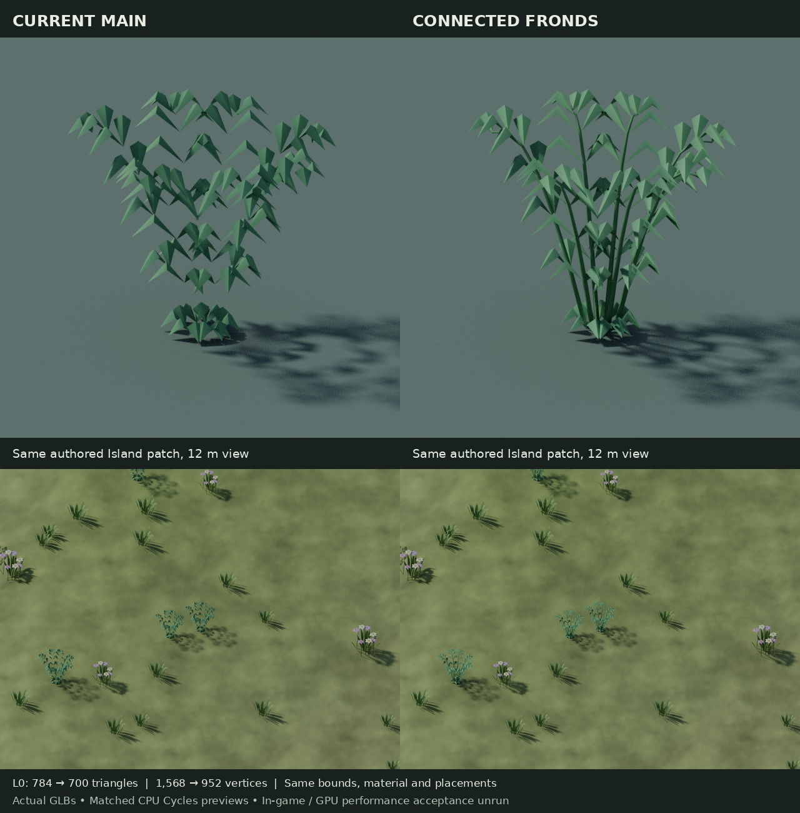
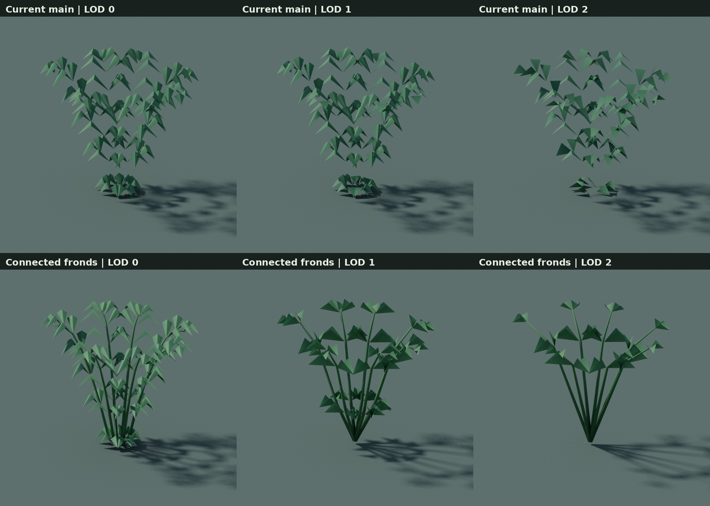

# Connected Island Fern fronds, 2026-10-16

This is a bounded source/asset improvement based on main `73f8ecf03`. The original
Fern generator authored paired folded leaflets but no ribs or stipes. Its three
runtime nodes/meshes each have one primitive, and the runtime selects that named
primitive. The floating leaflet islands were present in the actual asset, rather
than caused by importer visibility or choosing the wrong LOD.

The new editable Blender 4.3.2 source gives every frond a continuous tapered green
rib. Each leaflet directly shares its base vertex with the rib in native topology.
It reallocates redundant leaflet segmentation, retaining the existing folded near
leaf outlines and palette. All three LODs keep all seven original frond directions
and their outer tip rung. Middle/overview simplify leaflet folds and rung density.

| LOD | Before/after triangles | Before/after exported vertices |
| --- | ---: | ---: |
| L0 | 784 / 700 | 1,568 / 952 |
| L1 | 352 / 294 | 1,056 / 441 |
| L2 | 156 / 154 | 468 / 231 |

The runtime shrinks from 97,100 to 55,168 bytes. Exact per-LOD AABBs, pivots,
identity nodes, names, scene roots, material definitions and one-primitive bindings
are retained. There are no new textures, shaders or material slots. Placements,
collision, terrain, other plants, Broadleaf, Conifer, boulders and creature state
are unchanged. Lower geometry counts alone do not establish FPS improvement.

The current Grass and Flowers already have coherent folded forms and are retained.
CoastalShrub's smooth oval pads remain a possible later visual target; they are not
part of this change.

## Actual matched asset evidence

The previews import the real GLBs under identical fixed daylight, cameras, AgX
and CPU Cycles settings. The Island patch keeps authored XZ, yaw and scale and
uses the current runtime near-triangle plant-grounding rule. Close/reverse and
12/24 metre patch views were inspected. They are offline Blender previews, not
Bevy game capture. Live LOD transitions, gameplay visual acceptance, physical GPU
timing, FPS and whole-workspace acceptance remain unrun. Current culling never
displays Fern L2; its seven-direction fan is retained and checked anyway.

## Source ownership and checks

`fern-connected-fronds.blend` owns the new geometry. The older color-only Fern
source/baseline and its historical checker remain unchanged. The exact pre-pass
runtime is retained as `fern-connected-fronds/Fern.baseline.glb`. Normal export
reopens the current editable source without reapplying the sculpt. The guarded
optional author step accepts only that exact baseline. No review-workspace paths
or external images are required by the shipped source/export flow.

The fixed Fern successor audits the entire current art/world file set, all 48
manifest entries and the preserved earlier recipes/checkers. Only the existing
Fern registration's size, digest and generator change. The prior full-art profiles
still certify only their pinned earlier snapshots. The existing CPU art CI lane
runs the new successor, Fern negative cases and retained Broadleaf geometry cases;
it does not add a duplicate frontend build.

The native check confirms seven rooted connected fronds per LOD, with no unused
vertices or zero-area polygons. Exported shading vertices may split at flat
leaf/rib normal boundaries; native topology is the connectivity claim. The GLB
check confirms exact bindings/bounds, all vertices indexed, unit normals,
normalized U8 colors, no degenerate triangles and lower triangle/vertex ceilings.
Khronos Validator reports 0 errors/warnings/infos/hints. Clean `python -S` checks
require only the standard library.

The repository-relative source reload/export exactly reproduces the reviewed
runtime. [Source/export receipt](2026-10-16-connected-fern-fronds/source-export.json),
[native topology](2026-10-16-connected-fern-fronds/native-topology-check.json),
[render hashes](2026-10-16-connected-fern-fronds/render-receipt.json) and
[validator output](2026-10-16-connected-fern-fronds/gltf-validation.json) retain the
evidence and its limits. Blender 4.3.2 was already installed. Only the temporary
Khronos npm validator package was added for this review; no user-PC activity,
training, image generation or heavy local build was used.
