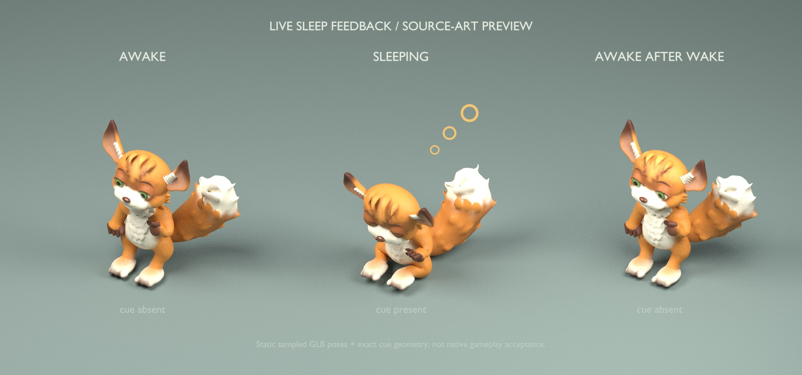

# Live sleep feedback — 18 October 2026

The ordinary renderer now shows three small amber bubbles beside a living
individual in authoritative EnteringSleep, Consolidating or ForcedRecoverySleep.
Awake and Waking show none, regardless of fatigue, sleep pressure or Rest pose.
This completes the sleep-effects portion of the
[care-readability commitment](../core-game-loop-plan-2026-09-20.md#2-make-care-direct-and-readable).

The renderer matches stable world and organism identity across the displayed
root, visual marker, live object and organism row. Missing authority, mismatched
identity, death, removal and load clear the cue. The hierarchy follows the
displayed position and terrain height between world ticks; pause freezes its
slow breath pulse. Scale cancellation precedes billboard rotation so inherited
nonuniform proportions cannot shear the rings. Selection highlights the body
while excluding the cue meshes from material cloning.

At most eight individuals share one mesh and one material. No particle emitter
is created. Legacy launch-time SleepGlow selection is removed; unrelated
authored-terrain effects remain disabled. Simulation, biology, training,
acquired state and persistence code are unchanged.

## Focused verification

Eight CPU/ECS regressions cover phase truth, missing and mismatched identity,
living lifecycle, actual affine transforms, inter-tick following, pause and
speed, wake/removal/load cleanup, stable capacity selection and shared assets.
The selection integration test runs the real highlighter through repeated
sleep/wake and selection changes, retaining the body highlight and one shared
cue material. Current execution results and CI are recorded in
[PR #91](https://github.com/BobertNeek/A-Life/pull/91).

The eleven existing selection/highlight and pointer CPU regressions passed with
the production exclusion in place.

Core boundary checks and all 77 documentation assertions passed. The existing
art audit's current workflow source pin was refreshed for the added CI test
step; its historical profiles remain unchanged. Integration tests (3), art
composition tests (74), and the complete art audit passed.

## Static visual check

The [preview receipt](2026-10-18-live-sleep-feedback/preview-receipt.json)
records the approved GLB hash, source hashes, actual sampled poses, geometry and
render settings. Blender 4.3.2 / Cycles CPU rendered one 1920×900 image with
32 samples and four workers. It samples CuriousIdle, Sleep and CuriousIdle at
1/24 second; cue presence is illustrated, rather than driven by a running game.
The final local anchor is Y=1.90. Inspection found clear rings beside the
lowered sleeping silhouette without sampled head or tail clipping.

**Unknown:** native Bevy player-view acceptance on authored terrain, zoom and
occlusion behavior, and live gameplay lifecycle appearance. The preview uses
studio lighting and a neutral ground; it is not a game capture. No PC
qualification, training or performance measurement was performed for this work.
